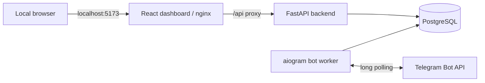

# BotForge

**A small, working Telegram multi-bot management platform for local development.** BotForge runs two Telegram bots through one Python backend, keeps their users and activity separate in PostgreSQL, and shows live operational data in a React dashboard. It is a public engineering proof of concept, not a hosted SaaS product.

## Implemented in v0.1.0

- Two aiogram 3 bots poll concurrently in a dedicated worker. Each bot resolves its real username through Telegram `getMe` and has its own database record.
- Shared `/start`, `/language`, and `/help` handlers support English and Arabic. Language preference is stored per user, per bot.
- PostgreSQL stores bots, registered users, and safe activity events. Registration is idempotent; raw message text is not stored in activity descriptions.
- FastAPI serves public `/health` and read-only admin endpoints for overview, bots, users, and activities. Admin routes require `X-Admin-Key`.
- A responsive React dashboard displays the real API results, with refresh, loading, empty, and error states. The admin key is entered manually and kept only in React memory.
- Docker Compose runs PostgreSQL, the API, the bot worker, and the dashboard locally. Alembic manages the schema.

[Screenshot guidance](docs/screenshots/README.md)

A connected dashboard screenshot can be added at `docs/screenshots/dashboard-overview.png` after personal data has been removed. No screenshot is included yet.

## Architecture



The API and worker use async SQLAlchemy sessions against the same PostgreSQL database. The worker applies migrations before polling. The dashboard serves a static Vite build and proxies `/api` to FastAPI on the Compose network. PostgreSQL and the worker publish no host ports. See [architecture notes](docs/architecture.md).

## Stack

| Layer | Technology |
| --- | --- |
| API and worker | Python 3.12+, FastAPI, aiogram 3 |
| Persistence | PostgreSQL 16, SQLAlchemy 2 async, Alembic |
| Configuration | Pydantic Settings, local `.env` |
| Dashboard | React 19, TypeScript, Vite, plain CSS, nginx |
| Verification | pytest, TypeScript, Vite build, Docker Compose |

## Quick start with Docker Compose

Install Docker with Compose. From the repository root, create a local environment file:

```powershell
Copy-Item .env.example .env
```

On macOS/Linux, use `cp .env.example .env`. Edit `.env` locally: replace the database password placeholder in both `POSTGRES_PASSWORD` and `DATABASE_URL`, and set a strong `ADMIN_API_KEY`. The password must match in both values; URL-encode special characters in the URL password. Keep the `db` hostname in `DATABASE_URL` for Compose. Never commit `.env`.

Start the database, apply the initial migration, and start the API and dashboard:

```powershell
docker compose up --build -d db
docker compose run --rm backend alembic upgrade head
docker compose up --build -d backend dashboard
docker compose ps
Invoke-RestMethod http://127.0.0.1:8000/health
```

Open **[http://127.0.0.1:5173](http://127.0.0.1:5173)** and enter your local admin key. The backend is also available at `http://127.0.0.1:8000`. Both host bindings are localhost-only.

### Connect Telegram bots

1. In Telegram, open the official **@BotFather** account and send `/newbot` twice. Follow its prompts to create two bots and obtain their tokens. See [Telegram's BotFather guide](https://core.telegram.org/bots/features#botfather).
2. Put the tokens in the local `.env` values `TELEGRAM_BOT_ALPHA_TOKEN` and `TELEGRAM_BOT_BETA_TOKEN`. Do not put tokens in source code, screenshots, issue reports, or shell history.
3. Start one polling worker:

   ```powershell
   docker compose up -d bot-worker
   docker compose ps
   ```

The web API works without bot tokens; the worker requires both. Run only one worker replica for these tokens. The worker resolves usernames from Telegram, so no username configuration is needed. It applies outstanding migrations before polling and retries each bot independently after a failure. Stop it with `docker compose stop bot-worker`.

To check the bot flow manually from your own Telegram account, send `/start` to each bot and confirm each reply contains that bot's real username. Send `/language`, choose العربية, then send `/help` and ordinary text to confirm Arabic replies. Repeat on the other bot to confirm the preference is independent. Switch back to English if desired. Starting the worker sends no proactive messages.

## Admin API

All four endpoints below require the `X-Admin-Key` header. The API returns 401 if the key is missing or incorrect. Do not put the key in a URL or commit it.

| Endpoint | Contents |
| --- | --- |
| `GET /api/admin/overview` | Bot, active bot, user, and activity totals |
| `GET /api/admin/bots` | Bot identities, status, and registered user counts |
| `GET /api/admin/users` | Recent users, associated bots, language, registration date |
| `GET /api/admin/activities` | Recent safe activity descriptions and timestamps |

Users and activities return the latest 50 records by default; `?limit=` accepts 1–100. The dashboard reads these endpoints through a same-origin nginx proxy. It does not bundle or persist the key, and Disconnect or reload clears it.

## Development and tests

The backend can also run with Python 3.12+ and a separately available PostgreSQL instance. From `backend/`, install `python -m pip install -e ".[dev]"`, set `DATABASE_URL` to that database, run `alembic upgrade head`, then run `uvicorn app.main:app --host 127.0.0.1 --port 8000`. The application never creates tables at startup.

The dashboard can run with Node 22+: from `dashboard/`, run `npm ci`, then `npm run dev`. Vite proxies `/api` to the local backend.

Verification commands from the repository root:

```powershell
docker build --target test -t botforge-backend:test ./backend
docker run --rm --env-file .env botforge-backend:test pytest -q
docker compose exec -T backend alembic current
docker compose exec -T backend alembic check
docker compose config --quiet
cd dashboard
npm ci
npm run typecheck
npm run build
```

For a container-only frontend build, run `docker compose build dashboard`. See [release notes](docs/release-v0.1.0.md) for the first public release summary.

## Security and scope

BotForge is intentionally local. The API and dashboard bind to `127.0.0.1`; PostgreSQL and the worker do not publish ports. `.env` and local build artifacts are Git-ignored. No wildcard CORS policy is enabled. The admin API uses one shared key over local HTTP, which is sufficient only for this demonstration: there are no user accounts, sessions, RBAC, or production access controls. The dashboard is read-only.

**Future roadmap, not implemented:** dashboard pagination and filters, operational monitoring, production authentication, and deployment design. Media downloads, payments, subscriptions, Redis workers, and cloud hosting are outside v0.1.0.

## License

[MIT](LICENSE).
